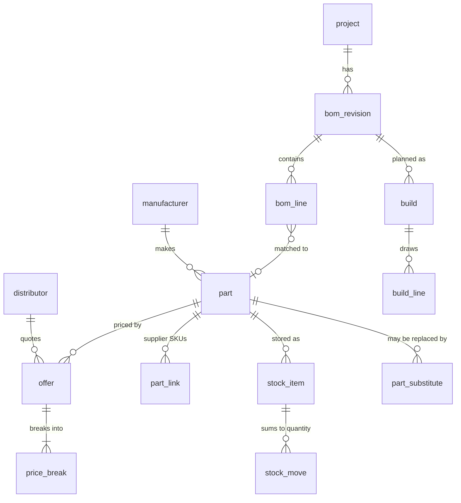

<p align="center">
  <picture>
    <source media="(prefers-color-scheme: dark)" srcset="docs/brand/shelfmark-lockup-dark.svg">
    
  </picture>
</p>

<p align="center">
  <strong>Parts inventory, BOMs and build tracking for people who assemble boards from KiCad.</strong>
</p>

<p align="center">
  <a href="LICENSE"></a>
  
  
</p>

Shelfmark answers four questions in one place: what parts do we have, where are they, do we have
enough for this board, and what goes in the machine.

---

## The problem

Small-batch electronics has four tools that do not talk to each other.

| Where it lives | What it knows | What it cannot tell you |
| --- | --- | --- |
| KiCad | What the board needs | Whether any of it is in the drawer |
| The drawers | What you own, roughly | Which MPN, which value, how many |
| The distributor's site | Price and stock, for them | What you already paid, or own |
| The pick-and-place | Where the parts go | Which parts you actually have |

The join between them is a spreadsheet that somebody updates after a build, if they remember.
Then a BOM revision lands, and nobody can say whether the last three boards consumed enough
resistors to matter.

Shelfmark is that spreadsheet, with a ledger underneath it.

## What it does

**Parts with one identity.** Every part gets an internal part number (`SK-00042` by default). The
MPN, manufacturer, package, datasheet and images hang off it, and any number of supplier part
numbers point at it. Manufacturer part numbers are normalised, so `RC0402FR-0710KL` and
`rc0402fr-0710kl ` are the same part.

**Supplier offers and price breaks.** Record what a distributor charges at each quantity, or
refresh it from DigiKey's Product Information API when credentials are configured, against a daily
call budget so a refresh loop cannot burn the quota. Money is stored as integer micro-dollars; no
floating-point pennies.

**BOM import from KiCad.** Drop in the CSV export. Headers are matched by alias (`Ref` /
`Reference` / `Designator`, and so on), DNP lines are respected, references are expanded, and every
line is matched to a part by manufacturer part number. A new revision produces a **diff** against
the previous one: added, removed, changed quantity, changed part. Unmatched and ambiguous lines are
shown as such, with a resolve action, rather than being quietly dropped.

**Labels instead of typing.** Photograph a DigiKey or Mouser bag and Shelfmark reads the Data
Matrix and the linear codes. It finds or creates the part, pulls the MPN, quantity, lot, date code,
country and purchase order off the label, and records the receipt. Mouser labels that carry no
manufacturer part number in the 2D symbol are recovered from the linear code; a label whose 2D code
will not read at all is still prefilled from the bars, and nothing is written until you confirm.

**A stock ledger, not a number.** Every quantity change is a recorded move — receive, consume,
scrap, adjust, move, build — with an actor, a note and a resulting balance. Quantity is derived from
the moves and can never go negative. Correcting a mistake means recording a correction, which is
what you want six months later.

**Substitutes that are a claim about the board.** Link a part to an equivalent, a form-fit
alternative, or a different part entirely, with a note that says why. Form-fit links require a note.
Suggestions are drawn from the same package and value, so a reel of 10 k 0402 can stand in for
another, and the revision page shows which substitutes would cover a shortage and which would not.

**Builds.** Plan N boards against a revision and see, line by line, what is short and what could
cover it. Commit the build and stock is consumed atomically: if any line is short, nothing is
written and the message names the line, the required quantity and the shortfall. A committed build
is immutable.

**The OpenPnP handoff.** Download a pick list (part, MPN, package, quantity, bin, substitutes) and
an OpenPnP board file built from a KiCad position export: one placement per reference, with real
coordinates, part IDs and rotation, plus a job file that names the board once. It removes the
copying of coordinates by hand.

**Access that suits a bench.** Three roles — viewer, engineer, admin. Humans log in with a
password and a session; machines use API keys. On first run, if no account exists, the app sends
you to a setup page to create the first admin.

## How a board gets built

The loop the whole tool is built around. Everything after the BOM is derived from stock that is
already on the shelf.

```mermaid
flowchart TD
  bom["KiCad BOM<br/>CSV export"] --> match["Import and match"]
  match --> q1{"Any line<br/>unmatched?"}
  q1 -->|yes| fix["Resolve the line,<br/>or create the part"]
  fix -->|re-import| match
  q1 -->|no| rev["Revision, with a diff"]
  rev --> plan["Plan N boards"]
  plan --> q2{"Stock covers<br/>every line?"}
  q2 -->|no| short["409 naming the line,<br/>need, have and shortfall"]
  short -->|receive, or link a substitute| plan
  q2 -->|yes| commit["Commit: draws stock<br/>in one transaction"]
  commit --> ledger["A ledger row<br/>for every draw"]
  commit --> pnp["Pick list, board.xml,<br/>job.xml"]
```



Nothing in the middle of that picture is a guess. An unmatched line stops the import until someone
resolves it. A short line stops the commit and names the numbers. The draws are written in one
transaction, and the OpenPnP files are generated from the committed build, so they describe the
stock that was actually taken.

## The shape of the data

The schema is small enough to hold in your head. The one relationship that matters is the ledger: a
stock item's quantity is the sum of its moves, and nothing else writes it.



That shape is why a mistake is correctable six months later: the moves are still there, in order,
with the actor and the note.

## Why this rather than something else

**A spreadsheet** is free and infinitely flexible, and for fifty parts in a drawer it may be
enough. It cannot enforce a ledger, cannot match a BOM to stock, and breaks the moment two people
edit it. Shelfmark is the same idea with the arithmetic done for you.

**InvenTree or PartKeepr** are general parts databases with purchase orders, multi-warehouse
support and a wider inventory model. If you need those things, use them. Shelfmark is deliberately
narrower: it assumes one bench, one person or a small team, parts arriving in bags from two
distributors, and boards coming out of KiCad. That narrowness is why a BOM revision, a scanned bag
and a pick-and-place job are three clicks apart instead of three integrations.

**Distributor BOM tools** price a design. They do not know what is already in your drawers, what
you paid last time, or that a substitute arrived in a different package.

**One container, one file.** SQLite, no external services, no queue, no Redis, no Postgres. Back up
by copying `/data`. The container runs read-only with a single writable volume, as a non-root user.

## Status

Working and in daily use on a real project. 241 tests at 84% coverage, ruff, ruff-format, mypy,
bandit and pip-audit clean on Python 3.11 and 3.12. CI gates all of it, builds and publishes the
image.

| Area | State |
| --- | --- |
| Parts, IPNs, MPN normalisation, datasheets, images | done |
| Users, sessions, API keys, roles, rate limiting | done |
| Supplier offers, price breaks, DigiKey refresh | done |
| BOM import, matching, revisions, diff | done |
| Stock ledger, locations, moves | done |
| Label scanning (DigiKey, Mouser) and receipt | done |
| Substitutions and shortfall coverage | done |
| Builds, atomic commit, OpenPnP export | done |
| Export/restore, nightly refresh, multi-arch image | next |

### What it does not do yet

No serial-number or lot traceability beyond the lot text on a scanned bag. No purchase orders
beyond storing the PO number from a label. No multi-tenant or multi-warehouse model. The OpenPnP
board file references parts by internal part number; OpenPnP still needs its own part definitions
for nozzle and feeder setup, which the pick list is there to help you create.

## Running it

### Container

```bash
docker compose up --build
```

Then open <http://localhost:8080>. With no accounts yet, you are sent to `/setup` to create the
first administrator.

Data lives in the `shelfmark-data` volume (`/data` inside the container): the SQLite database and
the asset directory. That volume is the whole backup.

### Development

```bash
uv venv
uv pip install -e ".[dev]"
uvicorn app.main:app --port 8080
```

### Checks

```bash
ruff check app tests
ruff format --check app tests
mypy app
pytest -q --cov=app --cov-report=term-missing --cov-fail-under=83
bandit -q -c pyproject.toml -r app -ll
pip-audit
```

The coverage gate fails the build below 83%; the suite sits at 84%, and the number ratchets up
rather than down. `bandit`'s three skips are documented in `pyproject.toml`.

### Break-glass CLI

The container ships a CLI for the cases the web UI cannot reach — creating an admin when nobody
can log in, revoking a key, importing a BOM in a script:

```bash
shelfmark key create --name ci --role engineer
shelfmark user create sydney --role admin
shelfmark build plan 2 --boards 10
```

## Configuration

Everything comes from the environment, prefixed `SHELFMARK_`. The defaults are sensible for a
single-user install.

| Variable | Default | Meaning |
| --- | --- | --- |
| `SHELFMARK_DATA_DIR` | `./data` | SQLite database and job packages |
| `SHELFMARK_ASSET_DIR` | `/data/assets` | Hosted datasheets and images |
| `SHELFMARK_LISTEN_PORT` | `8080` | Listen port |
| `SHELFMARK_HOST` | `0.0.0.0` | Listen address |
| `SHELFMARK_LOG_LEVEL` | `info` | Log verbosity |
| `SHELFMARK_IPN_PREFIX` | `SK` | Prefix for generated internal part numbers |
| `SHELFMARK_AUTH` | `on` | `none` disables auth; refused when `SHELFMARK_ENV=production` |
| `SHELFMARK_ENV` | `development` | Environment name |
| `SHELFMARK_RATE_LIMIT` | `600` | Requests per minute per API key, `0` disables |
| `SHELFMARK_BOOTSTRAP_KEY` | *(generated)* | First admin key on an empty key table |
| `SHELFMARK_DIGIKEY_CLIENT_ID` | *(unset)* | DigiKey API v4 client id; enrichment stays queued without it |
| `SHELFMARK_DIGIKEY_CLIENT_SECRET` | *(unset)* | DigiKey API v4 client secret |
| `SHELFMARK_DIGIKEY_DAILY_BUDGET` | `1000` | Daily DigiKey product lookups |
| `SHELFMARK_QUEUE_TICK_SECONDS` | `900` | How often the app drains the enrichment queue; `0` disables |

## Documentation

- [User guide](docs/USER-GUIDE.md) — deploying, the first hour, and every screen explained
- [API reference](docs/API.md) — every route, its role and its response
- [CLI reference](docs/CLI.md) — every command the container ships
- [Design notes](docs/) — the milestone documents, including the decisions and the things that
  went wrong on the way

## Licence

MIT. See [LICENSE](LICENSE).
